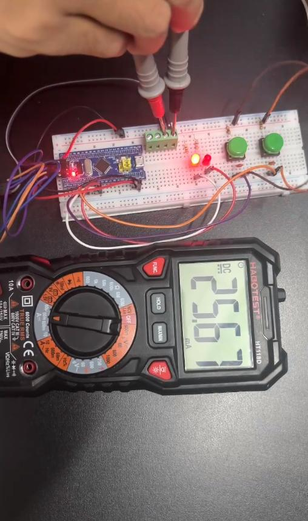
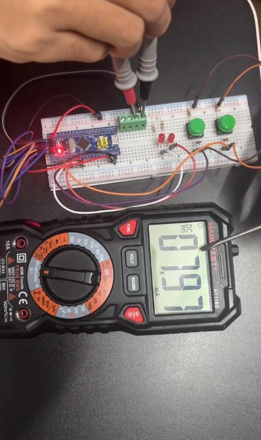
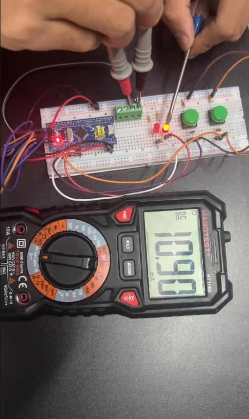
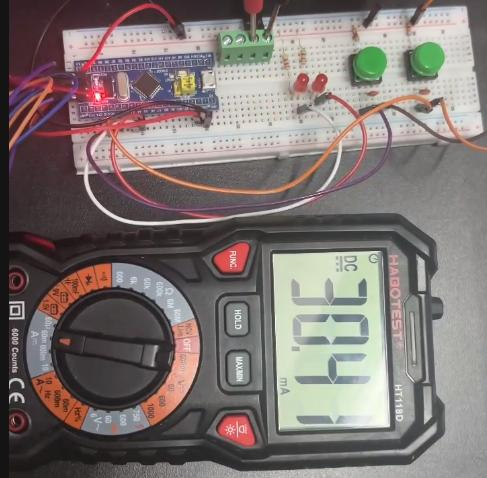
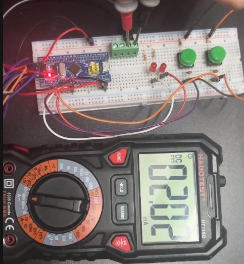
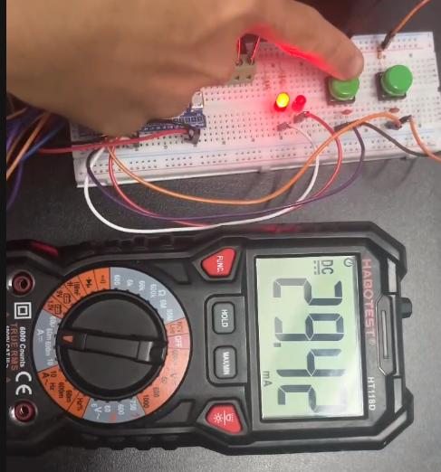
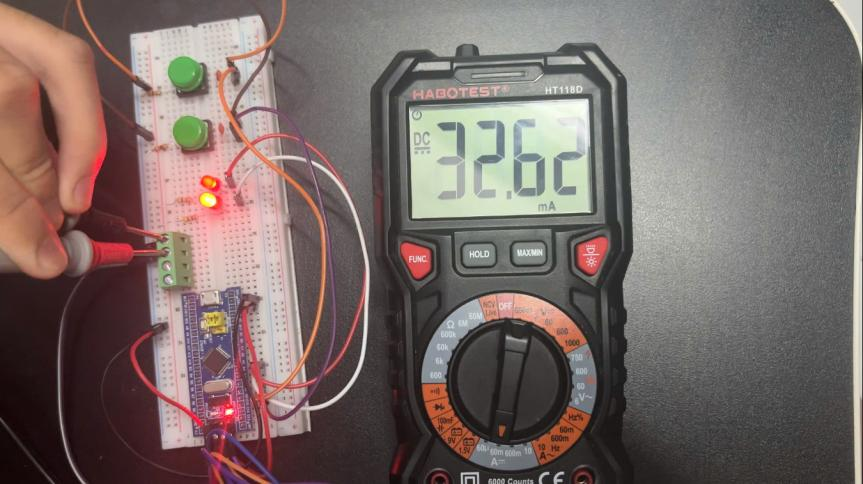
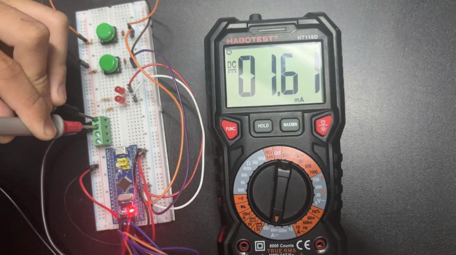

# STM32 Low-Power Modes: Sleep, Stop và Standby

Dự án khảo sát ba chế độ tiết kiệm năng lượng **Sleep**, **Stop** và **Standby** trên bo mạch **STM32F103C8T6 Blue Pill**. Repository gồm ba project firmware STM32CubeIDE độc lập; mỗi project minh họa một chế độ. Nút nhấn dùng để đưa vi điều khiển vào chế độ công suất thấp và đánh thức nó, LED hiển thị trạng thái chương trình, còn đồng hồ vạn năng dùng để ghi nhận dòng tiêu thụ ở cấp bo mạch.

## Mục tiêu

- Triển khai và quan sát hoạt động của Sleep, Stop và Standby trên STM32F1.
- Thử nghiệm các nguồn đánh thức và những xử lý firmware cần thiết sau khi MCU thức dậy.
- Đo dòng tiêu thụ ở từng chế độ và phân tích ảnh hưởng của bo mạch phát triển, mạch thử nghiệm lên kết quả đo.

## Phần cứng

- Bo mạch STM32F103C8T6 Blue Pill
- ST-LINK để nạp và gỡ lỗi qua SWD
- Breadboard, nút nhấn, LED và điện trở
- Đồng hồ vạn năng để đo dòng

**Nút nhấn và điện trở kéo xuống:** các nút nhấn ở PA0 và PA1 nối từ 3V3 xuống chân GPIO, mỗi chân có **điện trở kéo xuống (pull-down) 220 Ω bên ngoài** và một tụ 10 nF mắc song song với nút. Vì vậy trong firmware các chân này được cấu hình `GPIO_NOPULL`. Ở trạng thái nghỉ, chân ở mức LOW; khi nhấn nút, chân lên mức HIGH và tạo ra cạnh lên kích hoạt EXTI. Nếu đấu lại mạch mà không có điện trở này, chân sẽ thả nổi và có thể tự kích ngắt. Với điện trở 220 Ω, mỗi nút kéo khoảng 15 mA trong lúc được giữ, nên khi đo dòng cần thả nút trước khi đọc số.

**LED:** hai LED nối kiểu tích cực mức thấp: 3V3 → điện trở 10 kΩ → LED → chân GPIO (PA3, PA4). Ghi mức LOW thì LED sáng, mức HIGH thì LED tắt.

Schematic Proteus đi kèm dùng vi điều khiển STM32F103R6, trong khi bo mạch thực tế và firmware dùng STM32F103C8T6. Chỉ nên dùng schematic để tham khảo cách nối GPIO, không dùng số chân package trong đó để đấu bo C8T6.

## Phần mềm và công cụ

| Hạng mục | Công cụ và thành phần |
|---|---|
| Firmware | C, STM32 HAL, CMSIS; GPIO, EXTI, SysTick, PWR; TIM1 trong project Stop và Standby |
| Cấu hình | STM32CubeMX 6.18.1, file `.ioc` khai báo STM32Cube FW_F1 V1.8.7 |
| IDE và build | STM32CubeIDE (toolchain GNU Arm `arm-none-eabi-gcc`), nạp và gỡ lỗi qua ST-LINK |
| Schematic | Proteus, xuất ra PDF trong thư mục `docs/` của từng chế độ |

> Ban đầu các project được phát triển trên Keil MDK-ARM, sau đó chuyển sang STM32CubeIDE. Các file `.ioc` đã đặt toolchain là `STM32CubeIDE`; startup GCC, linker script và file project CubeIDE được sinh ra từ `.ioc` (xem phần Build và nạp firmware).

## Các chế độ đã triển khai

Mỗi chế độ nằm trong một project riêng; firmware không có menu chuyển chế độ khi đang chạy.

| Chế độ | Vào chế độ và đánh thức | Hoạt động của firmware |
|---|---|---|
| Sleep | Nhấn PA0 để vào Sleep; nhấn PA0 lần nữa để đánh thức | Tạm dừng SysTick, thực thi `WFI` trong vùng đã tắt ngắt; callback EXTI chỉ xóa cờ, vòng lặp chính khôi phục SysTick sau khi thức dậy |
| Stop | Nhấn PA0 để vào Stop; nhấn PA1 để đánh thức | Tạm dừng SysTick, vào Stop với bộ điều áp chính bật; ngắt PA1 đặt cờ đánh thức, vòng lặp chính cấu hình lại clock (HSE + PLL 64 MHz) và bật lại SysTick |
| Standby | Nhấn PA1 để vào Standby; PA0/WKUP đánh thức | Xóa cờ WU, bật chân WKUP rồi vào Standby; khi đánh thức, MCU reset và chạy lại từ đầu |

Sleep dùng HSI/2 với PLL ×16; Stop và Standby dùng HSE 8 MHz với PLL ×8. Cả ba project đều chạy xung hệ thống 64 MHz.

Các cờ dùng chung giữa ngắt EXTI và vòng lặp chính được khai báo `volatile`. Ở project Sleep, đoạn từ lúc kiểm tra cờ đến lệnh `WFI` chạy khi ngắt đang bị tắt (PRIMASK). Lệnh `WFI` vẫn đánh thức được MCU khi có ngắt chờ xử lý, còn hàm phục vụ ngắt chỉ chạy sau đó, nên không có race giữa ngắt PA0 và vòng lặp chính.

## Sơ đồ GPIO

| GPIO | Sleep | Stop | Standby |
|---|---|---|---|
| PA0 | Nút vào/đánh thức Sleep, EXTI0 cạnh lên | Nút vào Stop, EXTI0 cạnh lên | Nút đánh thức, chân WKUP |
| PA1 | Nút điều khiển LED PA4 (đọc trong vòng lặp) | Nút đánh thức Stop, EXTI1 cạnh lên | Nút vào Standby, EXTI1 cạnh lên |
| PA3 | LED nháy trong vòng lặp chính | LED đảo trạng thái bởi TIM1 (0,5 s) | LED đảo trạng thái bởi TIM1 (0,5 s) |
| PA4 | LED phản ánh trạng thái PA1 | LED nháy trong vòng lặp chính | LED nháy trong vòng lặp chính |

PA0 và PA1 là ngõ vào nút nhấn có điện trở kéo xuống bên ngoài, như mô tả ở phần Phần cứng. Khi chân WKUP được bật trong project Standby, phần cứng còn tự kích hoạt điện trở kéo xuống nội cho PA0.

## Kết quả đo dòng tiêu thụ

Các giá trị dưới đây lấy từ báo cáo và ảnh đo. Đây là dòng của **toàn bộ bo mạch và mạch thử nghiệm**, không phải dòng riêng của MCU. Tải và dòng ở trạng thái Run khác nhau giữa các thí nghiệm, nên không thể dùng các số này để so sánh trực tiếp ba chế độ trong cùng một điều kiện.

| Thí nghiệm | Trạng thái | Dòng điện |
|---|---|---:|
| Sleep | Run | ≈ 25.67 mA |
| Sleep | Sleep | ≈ 7.97 mA |
| Sleep | Sleep, một GPIO giữ mức HIGH | ≈ 10.90 mA |
| Stop | Trước khi vào Stop | 30.41 mA |
| Stop | Trong Stop | ≈ 2.02 mA |
| Stop | Sau khi đánh thức | 29.42 mA |
| Standby | Run | ≈ 32.62 mA |
| Standby | Standby | ≈ 1.67 mA |

Báo cáo Sleep và Standby phân tích rằng LED nguồn của Blue Pill (khoảng 1–1.3 mA) chiếm phần lớn chênh lệch giữa số đo và giá trị trong datasheet. Xem bối cảnh đo đầy đủ trong [báo cáo Sleep](Sleep_mode/docs/sleep_mode_report.pdf#page=38), [báo cáo Stop](Stop_mode/docs/Stop_mode_report.pdf#page=29) và [báo cáo Standby](Standby_mode/docs/Standby_mode_report.pdf#page=30).

<details>
<summary>Ảnh đo dòng điện</summary>

| Sleep: Run | Sleep | Sleep với GPIO ở mức HIGH |
|---|---|---|
|  |  |  |

| Stop: trước khi vào chế độ | Trong Stop | Sau khi đánh thức |
|---|---|---|
|  |  |  |

| Standby: Run | Standby |
|---|---|
|  |  |

</details>

Độ trễ đánh thức chưa được đo trong dự án này.

## Video demo

Video được lưu trong thư mục `Video/` của từng chế độ:

| Chế độ | Demo | Chạy thực tế |
|---|---|---|
| Sleep | [Demo Sleep Mode.mp4](Sleep_mode/Video/Demo%20Sleep%20Mode.mp4) | [Chạy thực tế Sleepmode.mp4](Sleep_mode/Video/Chạy%20thực%20tế%20Sleepmode.mp4) |
| Stop | [Demostopmode.mp4](Stop_mode/Video/Demostopmode.mp4) | [Chạy thực tế Stopmode.mp4](Stop_mode/Video/Chạy%20thực%20tế%20Stopmode.mp4) |
| Standby | [Demo Standby Mode.mp4](Standby_mode/Video/Demo%20Standby%20Mode.mp4) | — |

> Các video demo được quay khi project còn dùng **Keil MDK-ARM**; hiện tại project dùng **STM32CubeIDE**.

## Cấu trúc dự án

```text
Images/
  hardware/            Ảnh schematic
  results/             Ảnh đo dòng điện và mạch thử nghiệm
Sleep_mode/
  SLEEP_MODE/          Firmware Sleep: Core, Drivers, file .ioc (project CubeIDE sinh từ .ioc)
  docs/                Báo cáo và schematic PDF
  Video/               Video demo và chạy thực tế
Stop_mode/
  Stop_Mode/           Firmware Stop
  docs/                Báo cáo và schematic PDF
  Video/               Video demo và chạy thực tế
Standby_mode/
  Standby_Mode/        Firmware Standby
  docs/                Báo cáo và schematic PDF
  Video/               Video demo
```

| Chế độ | Cấu hình CubeMX | Mã nguồn chính |
|---|---|---|
| Sleep | [SLEEP_MODE.ioc](Sleep_mode/SLEEP_MODE/SLEEP_MODE.ioc) | [main.c](Sleep_mode/SLEEP_MODE/Core/Src/main.c) |
| Stop | [stopmode.ioc](Stop_mode/Stop_Mode/stopmode.ioc) | [main.c](Stop_mode/Stop_Mode/Core/Src/main.c) |
| Standby | [stanby_mode.ioc](Standby_mode/Standby_Mode/stanby_mode.ioc) | [main.c](Standby_mode/Standby_Mode/Core/Src/main.c) |

Mỗi project đi kèm các file HAL/CMSIS cần để build; các thành phần CMSIS không dùng tới (DSP, NN, RTOS, thư viện mẫu) đã được loại bỏ.

## Build và nạp firmware

Mỗi thư mục project đã có sẵn `.project`, `.cproject`, linker script `STM32F103C8TX_FLASH.ld` và startup `Core/Startup/startup_stm32f103c8tx.s`, nên có thể mở thẳng trong STM32CubeIDE.

1. Cài STM32CubeIDE.
2. Chọn *File → Import → General → Existing Projects into Workspace* và trỏ tới thư mục project (`Sleep_mode/SLEEP_MODE`, `Stop_mode/Stop_Mode` hoặc `Standby_mode/Standby_Mode`). Bỏ chọn *Copy projects into workspace* để làm việc trực tiếp trên repo.
3. Nếu muốn đổi cấu hình ngoại vi, mở file `.ioc` bằng STM32CubeMX 6.18.1 trở lên (gói STM32Cube FW_F1 V1.8.7) rồi bấm *Generate Code*; code trong các vùng `USER CODE BEGIN/END` được giữ nguyên.
4. Đấu nút nhấn (có điện trở kéo xuống) và LED theo bảng GPIO.
5. Trong CubeIDE, chọn *Project → Build Project*, sau đó *Run → Debug As → STM32 C/C++ Application* để nạp qua ST-LINK (SWD).
6. Thao tác nút theo bảng chế độ. Khi đo dòng, nên ngắt debugger và ghi lại cách cấp nguồn cùng trạng thái bo mạch.

Mỗi lần chỉ nạp một project lên bo mạch.

## Thành viên

Đây là dự án nhóm thuộc học phần **Hệ thống nhúng**. Phần việc của tôi gồm cấu hình các project STM32CubeMX cho ba chế độ, viết firmware vào chế độ công suất thấp và đánh thức, chạy thử trên phần cứng thực tế, đo dòng tiêu thụ và ghi nhận kết quả.

Xin cảm ơn hai thành viên cùng nhóm đã đồng hành trong dự án:

- [@NguyenVo-09](https://github.com/NguyenVo-09), repository gốc: [NguyenVo-09/stm32-low-power-modes](https://github.com/NguyenVo-09/stm32-low-power-modes)
- [@haquanghuy1230-wq](https://github.com/haquanghuy1230-wq)
